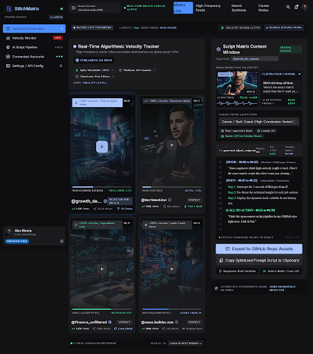

# StitchMatrix — Enterprise Organic Distribution Suite

[](LICENSE)
[](extension)
[](dashboard)
[](workers)

> High-velocity, precision-grade organic distribution command interface and in-DOM Chrome extension studio built for growth engineers, algorithmic marketers, and virality operators.



---

## Architecture Overview

StitchMatrix is organized as a unified monorepo divided into three modular layers:

```
stitchmatrix-monorepo/
├── dashboard/        # Cloudflare Pages React/Tailwind frontend application
│   ├── src/
│   │   ├── components/
│   │   │   ├── Header.jsx           # Cluster URL & real-time indicators
│   │   │   ├── ScriptStudio.jsx     # Script Matrix Studio & terminal
│   │   │   ├── Sidebar.jsx          # Collapsible navigation & account tier
│   │   │   ├── TelemetryBar.jsx     # Latency & edge node telemetry
│   │   │   └── VelocityMonitor.jsx  # Algorithmic anomaly tracker & sparklines
│   │   ├── App.jsx                  # 60/40 Split Architecture
│   │   ├── index.css                # Slate Dark Mode (#0F172A) styling
│   │   └── main.jsx
│   ├── package.json
│   └── vite.config.js
│
├── extension/        # Chrome Extension Manifest V3 In-DOM Sidebar
│   ├── icons/        # Generated icons (16px, 48px, 128px)
│   ├── background.js # Manifest V3 service worker & command dispatcher
│   ├── content.js    # Shadow DOM isolated 380px slider & UI components
│   ├── manifest.json # Scoped host permissions (TikTok, Shorts, Reels)
│   └── styles.css    # Sandboxed styling
│
├── workers/          # Cloudflare Workers Serverless API
│   ├── src/
│   │   └── index.js  # Edge handler: URL cleaner, velocity index & LLM engine
│   ├── test/
│   │   └── worker.test.js # Unit test suite
│   ├── package.json
│   └── wrangler.toml # Edge worker deployment configuration
│
├── DESIGN.md         # Full design tokens and typography specification
└── package.json      # Monorepo workspace configuration
```

---

## 1. Cloudflare Pages Dashboard (`/dashboard`)

The public-facing standalone web application dashboard replicates the Stitch design layout using React, Vite, and Tailwind CSS.

### Key Components
- **Telemetry Status Bar**: Live edge latency (14ms), cluster node telemetry, and global scrape rates.
- **Velocity Monitor (60% Left Pane)**: Real-time algorithmic spike tracker (>300% spike thresholds, audio hook frequency, retention anomalies, sparkline charts).
- **Script Matrix Studio (40% Right Pane)**: Optimization index (94.2% score), target market selector, tone & length badges, and the 3-frame script production terminal.
- **Design DNA**: Slate Dark Mode (`#0F172A`), Linear/Stripe caliber typography, and zero cyber-hacker tropes.

### Run Locally
```bash
cd dashboard
npm install
npm run dev
```

### Build for Cloudflare Pages
```bash
npm run build
# Deploys dist/ directory to Cloudflare Pages
```

---

## 2. Chrome Extension Manifest V3 Sidebar (`/extension`)

A sandboxed in-DOM slider component that injects the **Script Matrix Studio** directly into the desktop environments of:
- **TikTok** (`https://*.tiktok.com/*`)
- **YouTube Shorts** (`https://*.youtube.com/*`)
- **Instagram Reels** (`https://*.instagram.com/*`)

### Sandboxing & Zero Platform Disruption
- **Shadow DOM Root**: Guarantees that neither host platform styles disrupt the sidebar, nor do extension styles bleed into host video playback.
- **380px Slider**: Smooth `cubic-bezier(0.16, 1, 0.3, 1)` transition from the right edge.
- **Zero External Dependencies**: Pure native Web APIs and vanilla JavaScript for passive, lightweight execution.
- **Shortcuts**: Trigger with `Alt+S` or `Ctrl+Shift+S` (`Command+Shift+S` on macOS), toolbar icon, or the floating edge trigger tab.

### Load Unpacked Extension
1. Open `chrome://extensions/` in Chrome, Brave, or Edge.
2. Toggle **Developer mode** ON.
3. Click **Load unpacked** and select the `/extension` directory.

---

## 3. Cloudflare Workers Edge API (`/workers`)

Serverless backend microservices running on the Cloudflare edge.

### Endpoints
- `GET /api/health`: Health status and active edge nodes.
- `POST /api/analyze`: Intercepts social URLs, strips tracking query parameters (`utm_*`, `igsh`, `si`, `share_id`), and calculates real-time growth surge indices.
- `POST /api/generate-scripts`: Synthesizes 3 distinct, structured script mutations (`Contrarian`, `Tactical`, `Teardown`) formatted as `01 | Hook Element`, `02 | Core Thesis`, and `03 | Retentive Call-To-Action`.
- `POST /api/sync-github`: Handles asset and snapshot synchronization to GitHub.

### Test & Deploy
```bash
cd workers
npm test          # Run unit tests
npm run deploy    # Deploy via Cloudflare Wrangler
```

---

## Quality Assurance & Verification
- **Unit Tests**: Passed (`workers/test/worker.test.js` - 4/4 passing)
- **Frontend Build**: Passed (`dashboard` built in 1.29s with Vite)
- **Extension Integrity**: Manifest V3 compliant, Shadow DOM sandboxed
